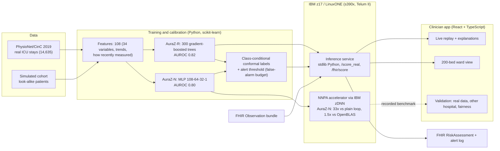

# AuraZ architecture

**Reading it:** data is turned into 108 features; two models are trained (trees for accuracy, a small neural network for the accelerator); each alert carries a conformal uncertainty label. The standard-library inference service runs on the z17 and feeds the app and a FHIR endpoint; the neural model runs on the on-chip AI accelerator through zDNN. Files: `ml/train_physionet_gbm.py`, `ml/train_physionet_mlp.py`, `ml/serve.py`, `ml/nnpa_mlp.c`, `src/`.
